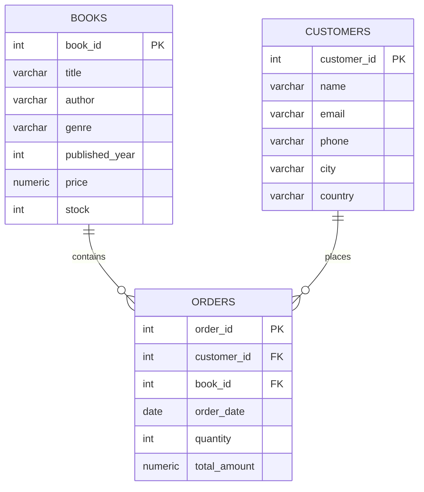

# Online Bookstore Sales Analysis with PostgreSQL


A portfolio project analyzing books, customers, sales, and inventory questions
using **PostgreSQL**. The project answers the 20 questions in the supplied
Online Bookstore SQL project brief, plus five exploratory SQL queries from my
original work.

**Author:** Arunaday Gupta  
**Skills demonstrated:** data modeling, SQL querying, joins, filters, aggregation,
`GROUP BY` / `HAVING`, sorting, dates, and exploratory analysis.

## Project overview

This project uses three relational CSV datasets:

| Table | Rows | Description | Primary key |
| --- | ---: | --- | --- |
| `books` | 500 | Titles, genres, authors, prices and stock | `book_id` |
| `customers` | 500 | Customer and location fields | `customer_id` |
| `orders` | 500 | Customer purchases, dates and totals | `order_id` |



## Sample findings

The figures below are calculated from the attached CSVs, not claimed as a
live PostgreSQL execution.

| Metric | Value |
| --- | ---: |
| Total recorded sales | **$75,628.66** |
| Total books ordered (units) | **2,697** |
| Sum of provided stock values | **25,056** |
| Records across all three tables | **1,500** |

**Inventory caution:** Subtracting all recorded orders from the supplied stock
figures gives negative results for 30 titles. This suggests the supplied stock
may not represent starting inventory. The project's final inventory query is
therefore a *hypothetical* calculation, not a validated inventory balance.

## Repository structure

```text
online-bookstore-sql-analysis/
├── README.md
├── LICENSE
├── .gitignore
├── data/
│   ├── books.csv
│   ├── customers.csv
│   └── orders.csv
├── sql/
│   ├── 01_schema.sql
│   ├── 02_load_data.sql
│   ├── 03_basic_queries.sql
│   ├── 04_advanced_queries.sql
│   ├── 05_exploratory_queries.sql
│   └── 06_data_quality_checks.sql
├── scripts/
│   └── validate_csv.py
├── docs/
│   ├── PROJECT_NOTES.md
│   └── SQL_Project_Questions_Day_30.pdf
├── original/
│   └── Project.sql
└── .github/workflows/
    └── validate.yml
```

## How to run locally

Requires **PostgreSQL** and the **`psql` command-line client**.

1. Clone or download the repository and open a terminal in its root directory.
2. Create a **dedicated** database and populate it:

```bash
createdb bookstore_db
psql -v ON_ERROR_STOP=1 -d bookstore_db -f sql/01_schema.sql
psql -v ON_ERROR_STOP=1 -d bookstore_db -f sql/02_load_data.sql
```

3. Run queries (query files contain multiple `SELECT` statements):

```bash
psql -d bookstore_db -f sql/03_basic_queries.sql
psql -d bookstore_db -f sql/04_advanced_queries.sql
psql -d bookstore_db -f sql/05_exploratory_queries.sql
psql -d bookstore_db -f sql/06_data_quality_checks.sql
```

4. Or inspect individual queries in pgAdmin Query Tool. If using pgAdmin
instead of `psql`, use its CSV import wizard for each table (books, customers,
then orders); the `\copy` command is **psql-specific** and will not run in pgAdmin.

**Warning:** `01_schema.sql` drops/recreates the three project tables. Do not
run it in a database containing data you want to retain.

**No PostgreSQL installed?** You can validate the CSV structure and recorded
order totals with Python's standard library:

```bash
python scripts/validate_csv.py
```

GitHub Actions runs this validation on every push/pull request.

## Analysis questions

**Basic (11):** Fiction titles; books after 1950; Canadian customers; orders
from November 2023; total stock; highest-priced title; customers purchasing
multiple units; orders above $20; distinct genres; lowest-stock book; revenue.

**Advanced (9):** units sold by genre; average Fantasy price; repeat customers;
most frequently ordered book; top-priced Fantasy books; units sold by author;
cities associated with orders above $30; highest-spending customer; hypothetical
remaining stock.

**Extras (5):** cross-year November orders, second-priced title, median book
price, top-seven frequently ordered books, and cities with qualifying
transaction amounts.

All SQL query files have numbered comments matching the assignment questions.
The original unmodified work is kept in [`original/Project.sql`](original/Project.sql).
For query interpretation and validation details, see
[`docs/PROJECT_NOTES.md`](docs/PROJECT_NOTES.md).

## Data and attribution

This project was developed while practicing SQL, using the supplied **Online
Bookstore** assignment brief and CSV files. The assignment material is included
for reference and is not claimed as original authorship.

**Before publishing publicly:** `customers.csv` includes names, email addresses,
and phone numbers. Review its privacy status and the dataset/PDF's reuse rights.
If sharing permission is unclear, publish only scripts and documentation (or
replace the original dataset with clearly licensed synthetic examples).

## Future extensions

- Add a dashboard for revenue, sales by genre, and customer trends.
- Add SQL-based automated result checks in a PostgreSQL CI environment.
- Define a documented inventory snapshot date for reliable stock reconciliation.
